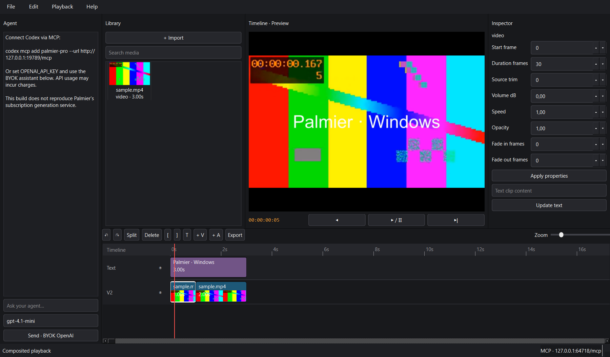

# Palmier Pro — native Windows/Linux development port 0.3.0

**Linux:** see [LINUX.md](LINUX.md) for the x86_64 build, dependencies and launch
instructions. Both platforms use the same native Qt editor and MCP tools.

**Real native Qt desktop application; incomplete GPL-source port.** This is not
a 1:1 or pixel-perfect release. It replaces the Swift/AppKit UI and Apple media
pipeline with Qt 6 Widgets and FFmpeg. No web server renders its interface.
The existing root Node/Electron experiment is separate and is not the native
application's entry point or backend.



Original: [Palmier, Inc.](https://github.com/palmier-io/palmier-pro), GPLv3
[`last-gpl-source`](https://github.com/palmier-io/palmier-pro/tree/last-gpl-source),
commit `8805801fa4df8bc2dbc57cb0a854a1f5108f95c6`. Later proprietary Palmier
releases are not the source baseline. See [migration](docs/MIGRATION.md), root
LICENSE and NOTICE, and [third-party notices](docs/THIRD_PARTY.md).

## Download and run

Download the **native Windows prerelease portable ZIP** from
[GitHub Releases](https://github.com/compotik2/palmier-pro-windows/releases).
Extract the entire directory; do not move the EXE away from `_internal`.
Run `PalmierProWindows.exe`. It is unsigned.

Requirements: Windows 10/11 x64 and FFmpeg/FFprobe **4.4 or newer** with
libx264/libx265/drawtext. Qt/Python runtime is included in the ZIP. FFmpeg is
not bundled; install it before launching:

```powershell
winget install --id Gyan.FFmpeg --exact
# Restart your terminal/session so the updated PATH is visible.
ffmpeg -version
ffprobe -version
```

Alternatively set absolute `FFMPEG_PATH` and `FFPROBE_PATH` environment
variables. Default port 19789 must be free for MCP; the editor still opens if
another program occupies it and reports the bind error.

## Editing workflow

1. File → Import (`Ctrl+I`) selects MP4/MOV/MKV/MP3/WAV/PNG/JPG files.
2. Double-click imported media to place it at the playhead, or drag from Library
   onto the timeline. Drag files from Explorer onto the window/timeline.
3. Add video/audio tracks with `+ V` / `+ A`. Track index 0 is the top visual
   layer. Click a clip, drag its body to move, or drag an edge to trim.
4. `Ctrl+K` splits at the playhead; Delete removes; `[` / `]` trim to playhead.
   `Ctrl+Z` undoes and `Ctrl+Shift+Z` redoes. Copy/cut/paste use Ctrl+C/X/V.
5. Inspector edits duration, source trim, speed, volume dB, opacity and fades.
   Text is added by `T` toolbar; update content in the inspector.
6. Click the ruler / arrows to seek. Space plays/pauses. Playback first builds
   a composited 720p cache with FFmpeg, then uses native Qt Multimedia with
   audio. Timeline edits invalidate that cache. This is accurate composite
   playback but **not immediate real-time multi-source preview**.
7. File → Save (`Ctrl+S`) creates a `.palmier` directory package. File → Open
   selects that directory. Save As requires a new destination. Media files
   imported by absolute path remain external references.
8. Export (`Ctrl+E`) supports MP4 H.264/H.265, resolution, Mbps bitrate, optional
   NVIDIA NVENC attempt with software fallback. Progress runs asynchronously.
   Export uses a model snapshot; later edits do not alter an active job.

## MCP / AI

The open app serves `http://127.0.0.1:19789/mcp` using stateless Streamable HTTP.

**OpenCode:** merge a `palmier-pro` entry into the existing `mcp` object in
`~/.config/opencode/opencode.jsonc` and restart OpenCode:
```json
"palmier-pro": { "type": "remote", "url": "http://127.0.0.1:19789/mcp", "enabled": true }
```
Run `opencode mcp list` while Palmier is open. The AI provider comes from the
user's OpenCode configuration; this is separate from in-app OpenAI BYOK chat.

```powershell
codex mcp add palmier-pro --url http://127.0.0.1:19789/mcp
```

Implemented tool subsets reuse original names and argument names:
`manage_project`, `get_timeline`, `get_media`, `import_media`, `add_clips`,
`move_clips`, `remove_clips`, `split_clips`, `set_clip_properties`,
`manage_tracks`, `add_texts`, `update_text`, `undo`, `create_timeline`,
`set_active_timeline`, `set_project_settings`, `export_project`, `manage_exports`.
Extensions: `windows_playback`, `windows_redo` (not original tools).
Only supported schema fields are advertised. This is **not all 50-tool parity**.
Examples:

```json
{"name":"import_media","arguments":{"source":{"path":"C:\\Media\\clip.mp4"}}}
{"name":"add_clips","arguments":{"entries":[{"mediaRef":"ID_FROM_IMPORT","startFrame":0}]}}
{"name":"split_clips","arguments":{"splits":[{"clipId":"CLIP_ID","atFrame":30}]}}
{"name":"export_project","arguments":{"outputPath":"C:\\Media\\finished.mp4","codec":"H.264","resolution":"1080p"}}
```

Loopback-only bind, strict Host validation, no browser Origin permitted, 1 MiB
request limit. Set `PALMIER_MCP_TOKEN` to require `Authorization: Bearer TOKEN`.
Local programs on the same account can control the editor when no token is
configured. External AI tools must use legitimate credentials. The optional
BYOK chat uses `OPENAI_API_KEY` and a configurable OpenAI model. Live API
integration is not tested without credentials; API charges depend on provider.
Import/export and project switching are excluded from in-app agent tool access.

## Compatibility / validation scope

| Feature | State |
|---|---|
| Native window, menus, Windows file dialogs, dark panels | Implemented; startup and automated UI interactions checked |
| Multiple video/audio tracks; move/split/delete/trim | Implemented; domain and representative UI tests |
| Undo/redo, atomic failure rollback | Automated tests |
| Audio mixing, gain, opacity, fade-in/out | FFmpeg implementation; representative media tests |
| Image/video/audio import | Real ffprobe; representative MP4/WAV/PNG tests; other containers require decoder support |
| Text overlays | Static centered text, fontSize/color; rendered pixels tested |
| Basic transitions | Linear fade-to/from-transparency/silence; no dedicated crossfade tool |
| Native playback with audio | Cache-rendered timeline, Qt decoder + CPU-presented native image; decoded frames/visible pixmap checked; audible listening needs manual review |
| Frame seeking, timeline zoom | Implemented; exact PNG seek via FFmpeg when cache absent; Qt cached seek may be codec-approximate |
| H.264 / H.265, 720p–4K / Mbps | Implemented; representative codecs/resolutions tested as listed in verification report |
| Hardware encoding | NVENC attempt plus controlled real-FFmpeg encoder-failure → software fallback tested; GPU success is host-dependent |
| Project save/load | Original core JSON keys; unknown fields preserved; not exhaustive upstream round-trip certification |
| Original MCP | 18 original-name subsets + 2 Windows extensions; no complete schema/behavior parity |
| BYOK OpenAI chat / external Codex | Adapter implemented; live provider/Codex session unverified |
| Linked AV clips, ripple, multicam, nested sequences | Not ported |
| Keyframes, effects, advanced transforms/crop, color/HDR | Not ported; unsupported rendering fails |
| Speech/transcripts/captions, beat/semantic models, Lottie | Not ported |
| Palmier subscription generation/backend | Not included |
| Original animations, shortcuts, SF icons, pixel-perfect UI | Not achieved; Mac baseline runtime unavailable |
| Signed EXE / installer | No signature; portable ZIP only |
| Windows 10 and Windows 11 separately certified | No; only the actual build host was executed |

Known limitations also include one active desktop project, single-thumbnail
filmstrips rather than position-specific thumbnails, no autosave, no collected-media export, in-memory export job
history, no media-relink UI, and constrained basic text styling. Do not edit
unsupported original linked/effected projects as if full compatibility exists.

## Build from source

Python **3.11 x64**, Git, FFmpeg/FFprobe 4.4+ on PATH:

```powershell
git clone https://github.com/compotik2/palmier-pro-windows.git
cd palmier-pro-windows\native
python -m venv .venv
.\.venv\Scripts\python.exe -m pip install -r requirements-lock.txt
.\.venv\Scripts\python.exe main.py
.\.venv\Scripts\python.exe -m unittest discover -s tests -v
.\.venv\Scripts\python.exe scripts/verify_desktop.py --output test-output\desktop.json
.\.venv\Scripts\python.exe scripts/build.py
```

Optional official MCP SDK integration test (Node.js 24):
```powershell
$env:PALMIER_TEST_PYTHON = "$PWD\.venv\Scripts\python.exe"
cd mcp-client
npm ci
npm test
```

Or use `powershell -ExecutionPolicy Bypass -File .\build.ps1` for tests, build,
and packaged startup. Output: `dist/PalmierProWindows/PalmierProWindows.exe`
and `dist/PalmierProWindows-0.3.0-win-x64-portable.zip` plus SHA256SUMS.
Dependencies are pinned; builds are reproducible in procedure, not asserted
byte-identical. `.github/workflows/native-windows.yml` builds on Windows runners.

## Manual acceptance plan (not claimed passed)

Import a MOV, MKV, MP3, JPG and a corrupt file. Drag assets/clip edges, seek,
listen to overlapping audio, mute/unmute, resize/zoom, edit during export,
cancel export via MCP, open/save on a removable drive, reopen a project after
moving an external asset, and compare clean same-size screenshots against a
running macOS GPL build. Repeat on Windows 10 and Windows 11 with and without
a supported GPU. Review focus/keyboard behavior in text inputs.
